# CodeQuest

**[Play CodeQuest](https://codequest-game-inky.vercel.app/)** · [Public source](https://github.com/amirh3sam/codequest-game)

A 2D adventure game that teaches programming in a modern tech city. Pick **Java, JavaScript, TypeScript or Python**, choose a hoodie developer, and help Kai repair a delivery drone. Predict a battery value, experiment with real code, then submit a repair to open a city lane. Explore two districts, solve coding terminals and challenge the Firewall and Router. Your code runs in the browser, with no account.

> Status: **Two distinct districts are playable in all four languages.** Walk with WASD/arrows or the mobile touch controls and press E to interact. Complete eight missions, restore the hub's power and operator signals, then solve the Firewall to unlock Logic Junction's elevated skyrail plaza. Areas 3–7 are coming next. See [docs/ROADMAP.md](docs/ROADMAP.md).

Keep **multiple saved adventures**, including several in the same language. The title screen lists every save under its language; use **Menu → Switch adventure** to manage them. Progress, event choices, hub repairs and tablet drafts stay separate. Existing language saves appear automatically.

Progress saves in this browser profile and survives refreshes. Use **Menu → Save backup file** to download a portable JSON backup, and **Load backup file** to restore it as another adventure. Keep that file somewhere safe to move progress between browsers or devices.

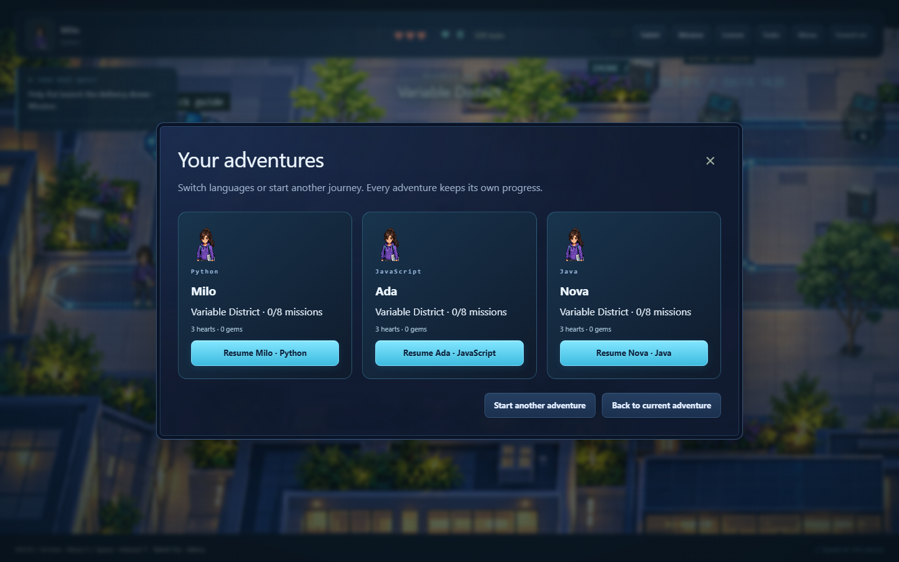

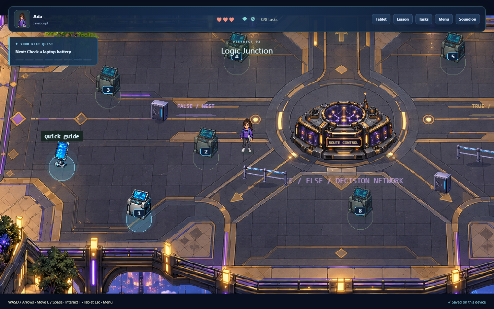

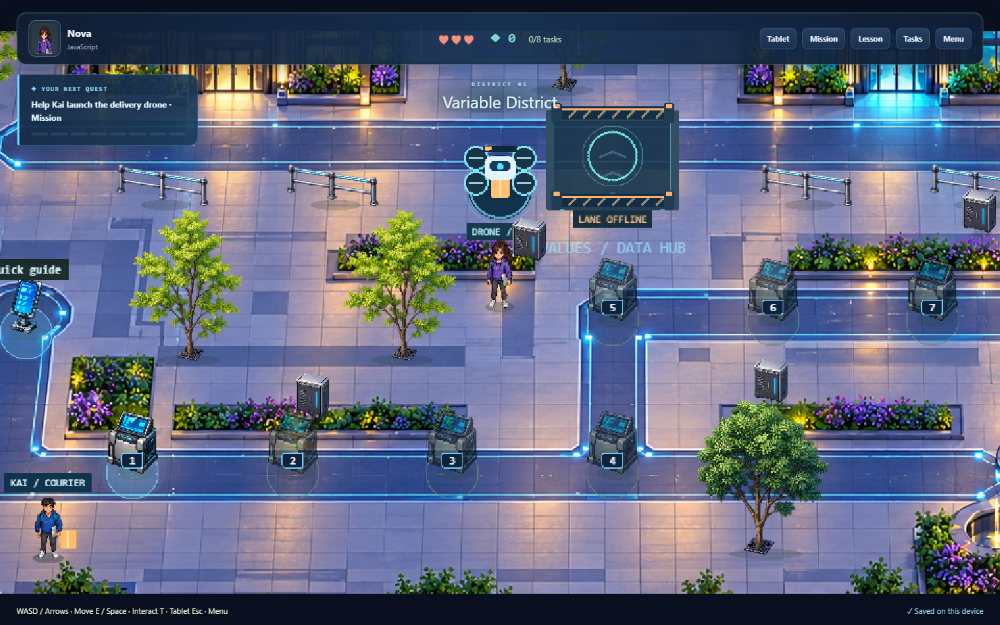

Start with **Mission** to meet Kai. The guided drone lesson lets you predict, run, investigate and change a battery value before writing your own repair. Practice previews are free; accepted repairs earn progress and change the city.

After repairing the drone, find the **community beacon** beside the courier lane, or open **Tasks → Optional discovery**. Help Mina choose **Garden night** or **Arcade night**, use a text variable to announce it, then light the courtyard in your event's colors. Free previews keep your hearts and gems safe. The saved choice earns the **Signal Maker** badge in your tablet mission log; you can change the event later.

The city also has **Packet Dash**, a standalone 2D runner at the glowing arcade cabinet. Jump the signal glitches, collect data bits and chase a personal best. It has its own shields and score, so arcade runs never cost coding hearts or gems; best scores save with that adventure. On touchscreens, use the Jump button.

<table align="center" width="100%">
  <tr>
    <td width="33%">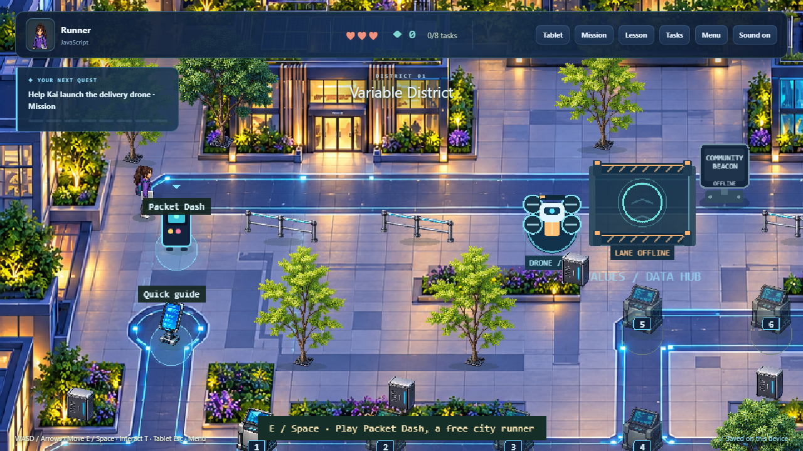</td>
    <td width="33%">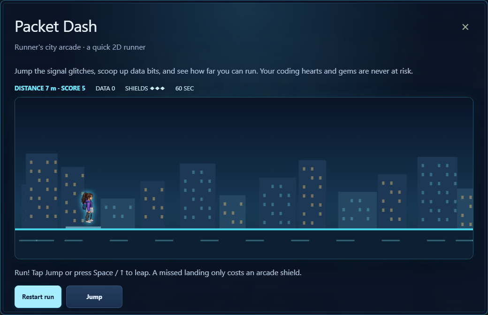</td>
    <td width="33%">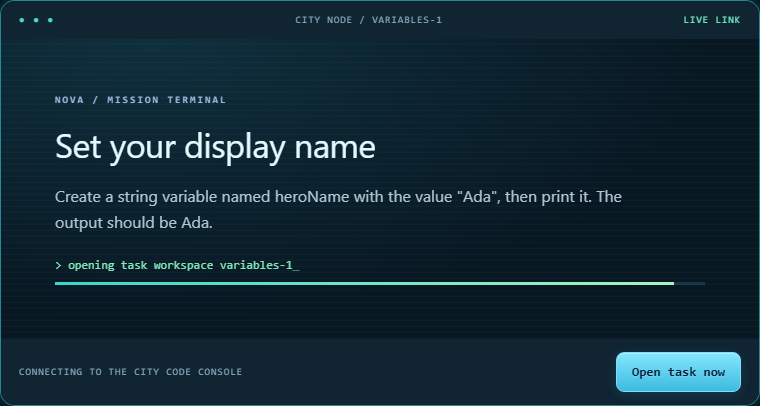</td>
  </tr>
  <tr>
    <td align="center"><sub><b>Explore the arcade</b></sub></td>
    <td align="center"><sub><b>Play Packet Dash</b></sub></td>
    <td align="center"><sub><b>Open a coding mission</b></sub></td>
  </tr>
</table>

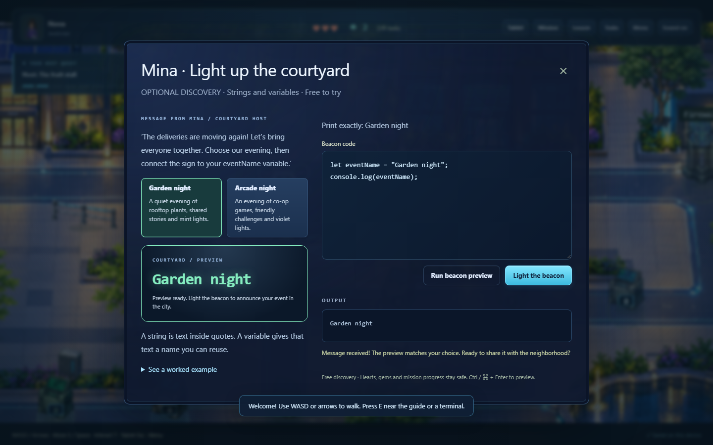

Sound effects include textured footsteps, tactile clicks, tablet swishes, soft error knocks and layered completion chimes. Set **Effects volume** in **Menu**, or use **Sound on/off** on the title screen or toolbar. Both settings stay on this device. Audio starts after an interaction and stops when the tab is hidden.

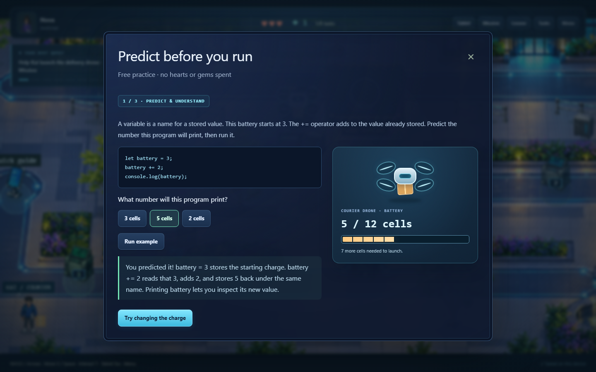

Press **T** or click **Tablet**: the city camera zooms toward your developer, then an illustrated **2D wrist tablet** lifts into view, settles and zooms into its screen. The opening takes three seconds. Press **T** or **Skip animation** to jump ahead. Reduced motion opens it instantly.

Coding tasks use a separate mission-console boot animation: the city node and task prompt load into a glowing terminal before the full-screen editor opens. Run code there and its output animates into the console below the editor. The wrist tablet remains its own practice space.

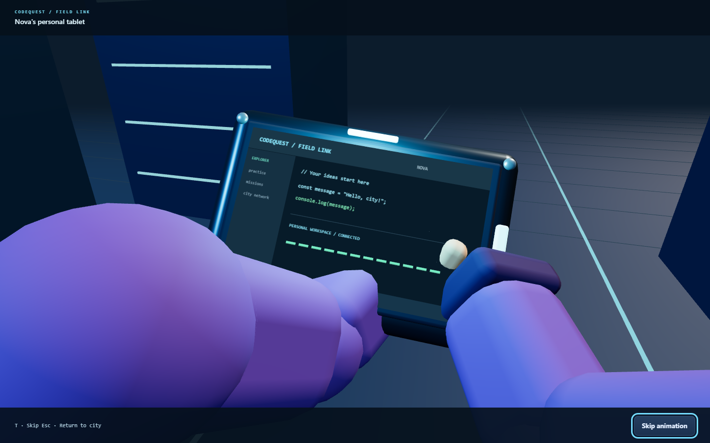

[Watch the actual tablet opening](docs/screenshots/tablet-opening.webm).

The full-screen tablet holds Editor, Examples, Console, Missions and Guide tabs. The editor, Run button and output stay together on one page, with results below your code. Each adventure has its own practice draft, and its missions open inside the device. Free practice never spends hearts or awards gems; mission submissions keep their normal grading rules. Press **Esc** to return to the city.

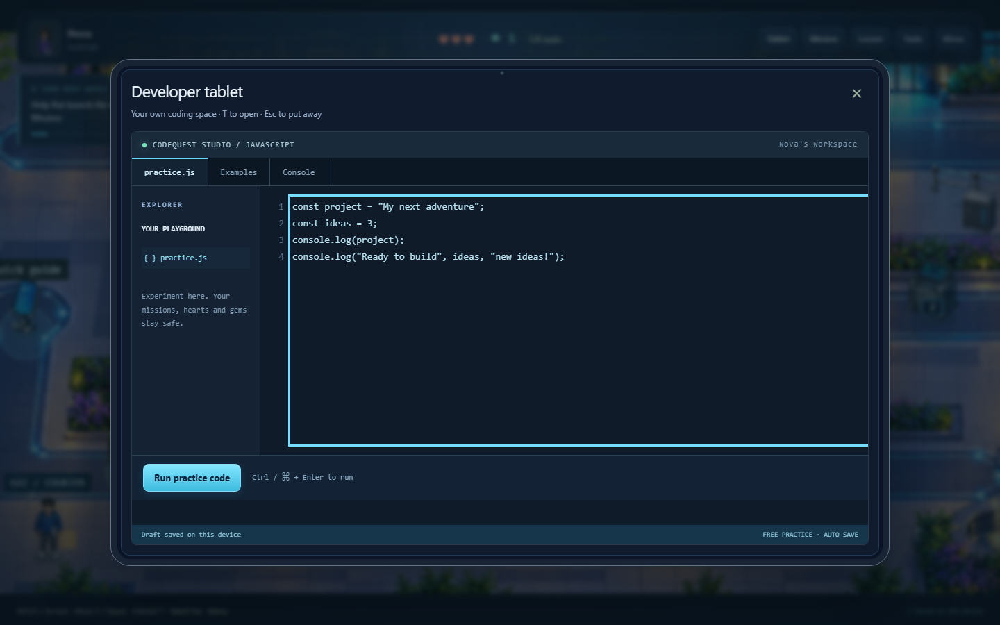

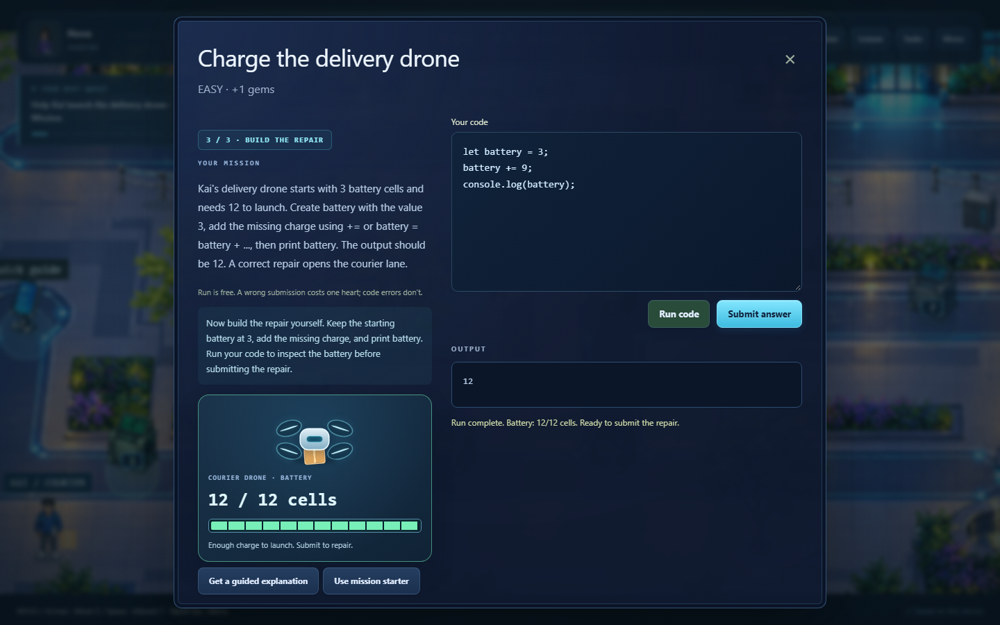

These are screenshots captured from the running game. [Capture notes](docs/screenshots/README.md).

Every player opening the shared link in their own browser profile has an independent character, mission progress and tablet drafts. Saves stay in that browser; they are not shared with other players or synchronized across devices.

## Run it locally
Requires Node.js 24+.

```bash
npm install
npm run dev          # open http://localhost:5173
```

## Develop
| Task | Command |
|---|---|
| Unit tests | `npm test` |
| E2E tests | `npx playwright install chromium` (once), then `npm run test:e2e` |
| Lint / format | `npm run lint` / `npm run lint:fix` |
| Type-check | `npm run typecheck` |
| Ruflo project tooling | `npm run ruflo -- <command>` ([setup](docs/RUFLO.md)) |
| Production build | `npm run build` then `npm run preview` |

## Docs
[PRD](docs/PRD.md) · [Architecture](docs/ARCHITECTURE.md) · [Roadmap](docs/ROADMAP.md) · [Decisions](docs/DECISIONS.md) · [Progress](docs/PROGRESS.md) · [Credits](docs/CREDITS.md)
