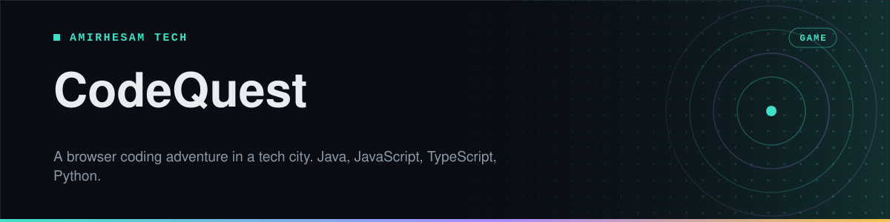
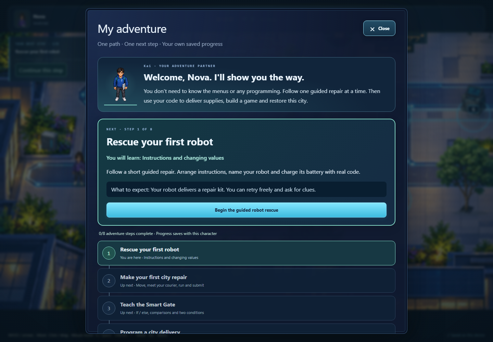
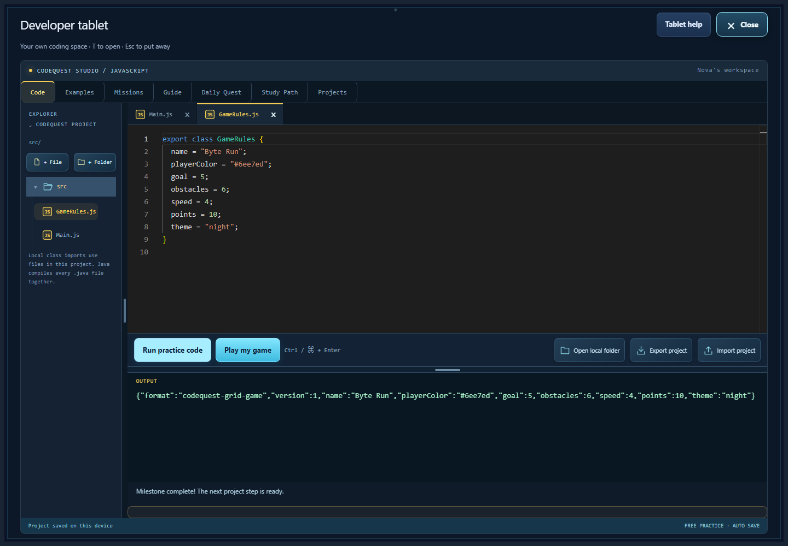

<p align="center">
  
</p>

<p align="center">
  <a href="https://codequest-game-inky.vercel.app/"></a>     <a href="https://github.com/amirh3sam/codequest-game/stargazers"></a>
</p>

<p align="center">
  <a href="https://codequest-game-inky.vercel.app/"><b>Play CodeQuest</b></a> ·
  <a href="#run-it-locally">Run it locally</a> ·
  <a href="#develop">Develop</a> ·
  <a href="#docs">Docs</a>
</p>

A 2D adventure game that teaches programming in a modern tech city. Pick **Java, JavaScript, TypeScript or Python**, choose a hoodie developer, and help your courier repair the city. Explore 23 districts, each with eight coding tasks and a boss. Your code runs in the browser, with no account.

**Never programmed before? Leave “Guided adventure” selected and press Start adventure.** Your courier opens **My adventure** automatically with one next action, what you will learn and what to expect. Follow eight steps: rescue a robot → complete your first city mission → teach the Smart Gate → program deliveries → build and beat your own game → restore the city → complete three review repairs → claim your room rewards. Each completed activity leads to the next; refresh and backups remember the actual progress. The city objective also has **Continue this step**. Experienced players can choose **Explore freely** instead.

Open **Menu → My adventure** or **Tablet → Guide → My adventure** to continue. Completed, current and upcoming steps appear in order. Expand **All activities · Free play** to revisit an activity whenever you want:



| Adventure | What your code changes |
| --- | --- |
| The Smart Gate | Test `if/else`, comparison boundaries and delivery badges against five visitors. |
| Robot companion | Program a loop or delivery list, then watch your named robot navigate real city paths. |
| Arcade Builder | Edit separate GameRules/Main files in any language, run them, save a custom collecting game and play it. |
| Restore the city | Reopen a useful workshop, start the existing district trams and repair the campus network. |
| Review adventures | Revisit a surprising answer with fresh examples of values, decisions and loops. |
| My developer room | Earn hoodie colors, robot shells/antennas and room decorations; equip them and see your city character change. |

The desktop and phone menus share seven choices: **My adventure, Tablet, Progress, World map, City activities, Help & controls, Save & profile**. Controls tours, the detailed player handbook and district examples live under Help; coding lessons follow My adventure. Saves and character management live together under Save & profile. Chapters, robot routes, playable game designs/records, restoration, review drafts and earned room rewards are included in **Save backup file**. Use the tablet's **Export project** separately to download editable coding folders/files. Download fresh copies after a study session; browser autosave cannot protect against cleared site data or a different device.

**Want to see the first-time experience again?** Use **Menu → Save & profile → Try as a new player**, or [open the fresh-start link](https://codequest-game-inky.vercel.app/?first-time=1). Start fresh guided adventure downloads a backup and creates a new guided copy of your character/language. Your original adventure and source projects remain in Saved adventures. Existing saves are never automatically reset or forced into the guided path.

> Status: **23 playable districts in all four languages, plus the learning adventures above.** Move with WASD/arrows, click a destination, or use mobile touch controls. Press E to interact. Eight tasks unlock each boss; defeating it unlocks the next district. See [docs/ROADMAP.md](docs/ROADMAP.md).

Keep **multiple saved adventures**, including several in the same language. The title screen lists every save under its language; use **Menu → Switch adventure** to manage them. Progress, event choices, hub repairs and tablet drafts stay separate. Existing language saves appear automatically.

Progress saves in this browser profile and survives refreshes. Use **Menu → Save backup file** to download a portable JSON backup, and **Load backup file** to restore it as another adventure. Keep that file somewhere safe to move progress between browsers or devices.


Choose from color-coded JavaScript, Python, TypeScript or Java, then start a personal adventure. The untimed first robot rescue introduces instruction cards, a name variable, battery predictions, a guided value replay and independent repairs with different inputs. Clues and unlimited retries help you practise. All four runtimes execute real code; Java's surrounding class/main method is supplied. Open **Progress** to see mission counts, the next skill and story chapter. **Help & controls → Accessibility & controls** offers larger text, high contrast and remappable movement keys. Practice previews are free; accepted repairs earn progress and change the city.

Use **Menu → City activities → Lighting console** to program the city's route lights. Choose the whole map or one task's circuit, then print online/offline and a color. Your real program changes the visible lights; each map/adventure remembers its own settings. Lighting practice never spends hearts or gems.

The **City Arcade** now offers Packet Dash, a 2D runner where you jump signal glitches and collect data bits, and Signal Stack, a timing game where you build a tower of relays. Both are optional, cost no coding hearts or gems, and save separate personal bests with each adventure. Touchscreens have dedicated game controls.

<table align="center" width="100%">
  <tr>
    <td width="33%"></td>
    <td width="33%"></td>
    <td width="33%"></td>
  </tr>
  <tr>
    <td align="center"><sub><b>Explore the arcade</b></sub></td>
    <td align="center"><sub><b>Play Packet Dash</b></sub></td>
    <td align="center"><sub><b>Open a coding mission</b></sub></td>
  </tr>
</table>


Sound effects include textured footsteps, tactile clicks, tablet swishes, soft error knocks and layered completion chimes. Set **Effects volume** or mute in **Menu → Help & controls → Accessibility & controls**; the title screen also offers mute. Both settings stay on this device. Audio starts after an interaction and stops when the tab is hidden.


Press **T** or click **Tablet**: the city camera zooms toward your developer, then an illustrated **2D wrist tablet** lifts into view, settles and zooms into its screen. The opening takes three seconds. Press **T** or **Skip animation** to jump ahead. Reduced motion opens it instantly.

Coding tasks use a separate mission-console boot animation: the city node and task prompt load into a glowing terminal before the full-screen editor opens. Run code there and its output animates into the console below the editor. The wrist tablet remains its own practice space.


[Watch the actual tablet opening](docs/screenshots/tablet-opening.webm).

The full-screen tablet has seven tabs: Code, Examples, Missions, Guide, Daily Quest, Study Path and Projects. Explorer and file tabs show colored file-format icons. The editor, Run button and output stay together; drag the handle above Output to resize it, or focus the handle and use arrows/Home/End. Your panel height is remembered. Open local folder, Export project and Import project manage the coding files and their separate backups. Each adventure keeps its own practice work; free practice never spends hearts or awards gems. Press **Esc** to return to the city. The top bar keeps Tablet, World map and Menu handy; Menu holds the other tools, adventure backups, sound and settings.




These are screenshots captured from the running game. [Capture notes](docs/screenshots/README.md).

Every player opening the shared link in their own browser profile has an independent character, mission progress and tablet drafts. Saves stay in that browser; they are not shared with other players or synchronized across devices.

## Run it locally
Requires Node.js 24+.

```bash
npm install
npm run dev          # open http://localhost:5173
```

## Develop
| Task | Command |
|---|---|
| Unit tests | `npm test` |
| E2E tests | `npx playwright install chromium webkit` (once), then `npm run test:e2e` |
| Lint / format | `npm run lint` / `npm run lint:fix` |
| Type-check | `npm run typecheck` |
| Ruflo project tooling | `npm run ruflo -- <command>` ([setup](docs/RUFLO.md)) |
| Production build | `npm run build` then `npm run preview` |

## Docs
[PRD](docs/PRD.md) · [Architecture](docs/ARCHITECTURE.md) · [Roadmap](docs/ROADMAP.md) · [Decisions](docs/DECISIONS.md) · [Progress](docs/PROGRESS.md) · [Credits](docs/CREDITS.md)

## About

Made by **[AmirHesam Tech](https://amirhesamtech.com)**. More tech content on TikTok: [@techwithamirh3sam](https://www.tiktok.com/@techwithamirh3sam).

If you enjoyed it, please give it a star. It helps other people find it.
