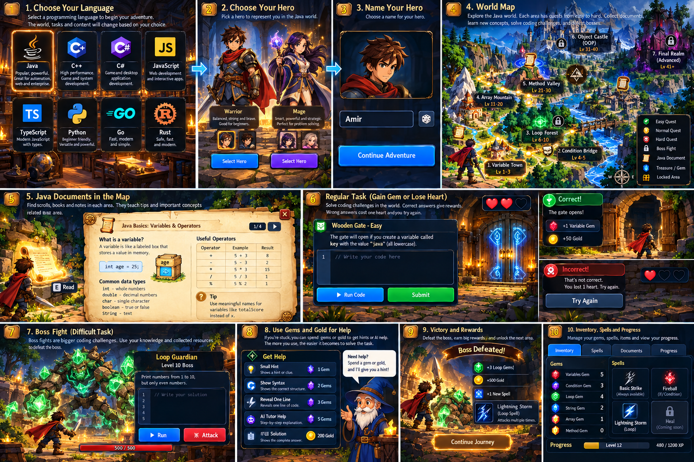

# CodeQuest

**[Play CodeQuest](https://codequest-game-inky.vercel.app/)** · [Public source](https://github.com/amirh3sam/codequest-game)

A 2D adventure game that teaches programming in a modern tech city. Pick **Java, JavaScript, TypeScript or Python**, choose a boy or girl developer with a hoodie, laptop and backpack, and explore Variable District and Logic Junction. Read digital guides, solve coding terminals to earn gems, and spend them on hints to beat the Firewall and Router challenges. Your code runs right in the browser: free, offline, no account.

> Status: **Two districts are playable in all four languages.** Walk with WASD/arrows and press E to interact. Complete eight missions and the Firewall in Variable District to unlock Logic Junction, with eight conditions missions and the Router. Travel between unlocked districts through Menu → World map. Progress saves automatically for each language. Areas 3–7 are coming next. See [docs/ROADMAP.md](docs/ROADMAP.md).



## Run it locally
Requires Node.js 24+.

```bash
npm install
npm run dev          # open http://localhost:5173
```

## Develop
| Task | Command |
|---|---|
| Unit tests | `npm test` |
| E2E tests | `npx playwright install chromium` (once), then `npm run test:e2e` |
| Lint / format | `npm run lint` / `npm run lint:fix` |
| Type-check | `npm run typecheck` |
| Ruflo project tooling | `npm run ruflo -- <command>` ([setup](docs/RUFLO.md)) |
| Production build | `npm run build` then `npm run preview` |

## Docs
[PRD](docs/PRD.md) · [Architecture](docs/ARCHITECTURE.md) · [Roadmap](docs/ROADMAP.md) · [Decisions](docs/DECISIONS.md) · [Progress](docs/PROGRESS.md) · [Credits](docs/CREDITS.md)
