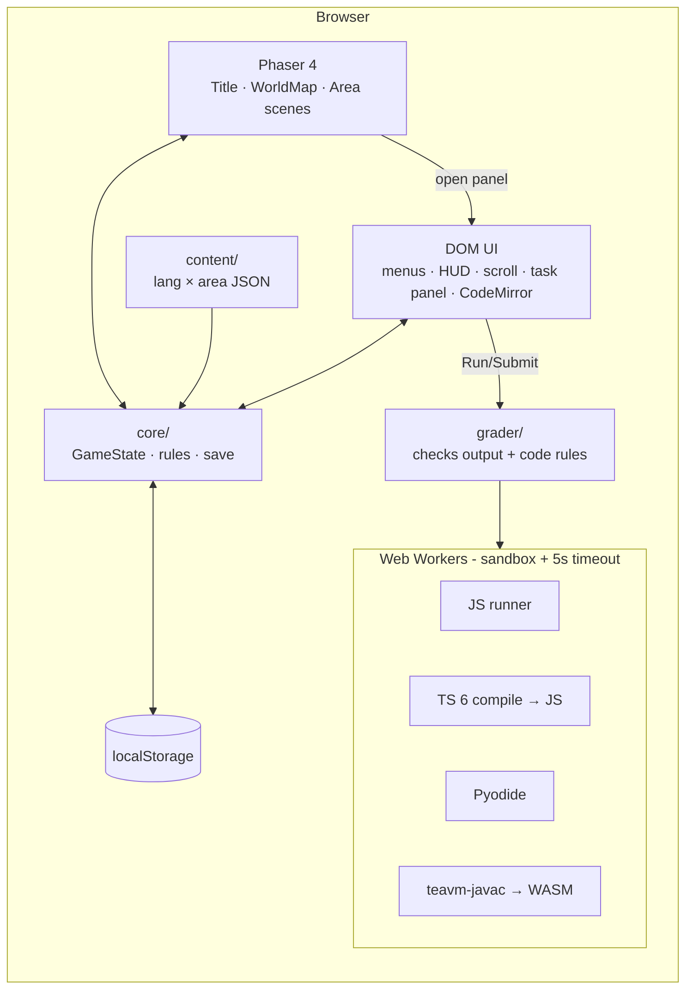

# CodeQuest — Architecture

_Last updated: 2026-10-04 · Versions checked on npm 2026-10-04_

## 1. Stack
| Area | Pick (version) | Why |
|---|---|---|
| Language | TypeScript 7.0.2 | Types catch bugs early; TS 7 (Go compiler) is the fast, current stable. |
| Build / dev server | Vite 8.3.2 | Standard, very fast dev server for browser games; easy Web Worker + WASM support. |
| Game engine | Phaser 4.2.1 (MIT) | Most-used free 2D web game engine; built-in Tiled tilemaps, arcade physics, sprite animation. |
| Maps | Tiled editor (free) → `.tmj` JSON | Industry-standard free map editor that Phaser loads natively. |
| UI panels (menus, scroll, task editor, HUD) | Plain TypeScript + HTML/CSS over the canvas | Text-heavy UI is easier and more accessible in DOM than in canvas; no extra framework needed. |
| Code editor | CodeMirror 6 (`codemirror` 6.0.2, `@codemirror/lang-java` 6.0.2, `lang-javascript` 6.2.5, `lang-python` 6.2.1) | Light, accessible, syntax highlighting for all 4 languages. |
| JavaScript runner | Browser JS engine inside a Web Worker | Free, instant, sandboxed in a worker. |
| TypeScript runner | `typescript` **6.0.3** (installed as alias `typescript-js`) in a worker → type-check + transpile → JS runner | TS 7 has no JS compiler API yet; TS 6 is the last JS-based compiler and runs in the browser. Real type errors are part of learning TS. |
| Python runner | Pyodide 314.0.7 (MPL-2.0) in a worker | Real CPython compiled to WebAssembly, free, offline. |
| Java runner | teavm-javac (Apache-2.0): OpenJDK javac + TeaVM compiled to WebAssembly, in a worker | Real `javac` in the browser, free, no server. Spike passed 2026-10-04 (see §6 limits). Fallback if ever needed: Piston in local Docker. |
| Unit / integration tests | Vitest 5.0.3 | Native to Vite, fast, Jest-compatible API. |
| End-to-end tests | Playwright 1.63.0 | Drives a real browser: needed to test WASM runners and the canvas game. |
| Lint + format | Biome 2.5.15 | One fast tool for both lint and format instead of ESLint + Prettier. |
| Save | `localStorage` (versioned JSON) | No server, no login; enough for MVP. |
| Art | Kenney CC0 packs (e.g. Tiny Town, Tiny Dungeon, Roguelike Characters) | Free for any use, consistent pixel-art style close to `reference/map-style-1.png`. |
| CI | GitHub Actions | Free for private repos within monthly minutes. |

## 2. Diagram


## 3. Folder structure (planned)
```
src/
  main.ts                 # boot: create Phaser game + UI root
  game/
    scenes/               # BootScene, PreloadScene, TitleScene, WorldMapScene, AreaScene
    entities/             # Hero, Interactable (scroll, task spot, boss)
    input.ts              # arrow/WASD/E/Esc, paused while typing
  ui/                     # DOM screens & panels: language, hero, name, hud, scroll, task, boss, pause, dialogs
  core/
    state.ts              # GameState type + pure reducers (solveTask, loseHeart, spendGems, resetArea…)
    rules.ts              # constants: hearts=3, gem rewards, hint costs, timeout
    save.ts               # load/save/migrate localStorage, per-language slots
    events.ts             # tiny typed event bus between Phaser and UI
  content/
    schema.ts             # TS types + runtime validator for content files
    loader.ts
    data/<lang>/<NN-area>.json   # java/01-variables.json, python/02-conditions.json …
  runners/
    types.ts              # Runner interface: run(code, stdin) → {stdout, stderr, compileError, timedOut}
    worker-host.ts        # spawns worker, enforces timeout (terminate + respawn)
    js.worker.ts  ts.worker.ts  python.worker.ts  java.worker.ts
  grader/
    grade.ts              # runs tests + code rules → GradeResult
public/
  assets/tiles/ sprites/ ui/ fonts/
  maps/area-01.tmj …      # one Tiled map per area (shared by all languages)
  runtimes/java/          # vendored teavm-javac files (6.7 MB, committed, hashes in README)
  runtimes/python/        # Pyodide (copied from node_modules by scripts/copy-runtimes.mjs, git-ignored)
tests/
  unit/                   # Vitest: core, save, grader, content schema
  e2e/                    # Playwright: flows + "every reference solution passes"
docs/
```

## 4. Data model

**Content file** (`src/content/data/<lang>/<NN-area>.json`)
```ts
type Area = {
  id: "variables" | "conditions" | "loops" | "arrays" | "functions" | "objects" | "abstraction";
  order: number; name: string;            // "Variable Village"
  lesson: { title: string; pages: { heading: string; body: string /* markdown */; code?: string }[] };
  tasks: Task[];                          // exactly 8, easy → hard
  boss: Boss;
};
type Task = {
  id: string; title: string; difficulty: "easy" | "normal" | "hard";
  prompt: string;                         // markdown
  starter: string; solution: string;      // solution is used by tests only, never shown in full
  tests: { stdin?: string; expectedStdout: string }[];
  rules?: { kind: "mustMatch" | "mustNotMatch"; pattern: string; message: string }[]; // regex on source
};
type Boss = Omit<Task, "difficulty"> & { name: string; hints: { cost: 1 | 2 | 3; text: string }[] };
```

**Save** (`localStorage["codequest:v1:<lang>"]`)
```ts
type Save = {
  version: 1; lang: "java" | "javascript" | "typescript" | "python";
  hero: { kind: "boy" | "girl"; name: string };
  currentArea: string; position?: { x: number; y: number };
  areas: Record<string, {
    solved: string[]; lessonsFound: boolean; gems: number; hearts: number;
    hintsBought: number; bossDefeated: boolean; drafts: Record<string, string>;
  }>;
  updatedAt: string;
};
```
Gems are stored per area: an area reset removes only that area's gems, and gems can only be spent on that area's boss.

## 5. Screens (no URL routes — single page)
Title (New / Continue) → Language → Hero → Name → World Map ↔ Area (HUD + panels: Scroll, Task, Boss, Pause, Out of hearts, Victory).

## 6. Code running and grading
1. `worker-host` keeps one warm worker for the chosen language and sends it `{id, code, stdin}`. Runs are **queued**: one request inside the worker at a time.
2. The worker compiles if needed (TS → JS, Java → WASM) and runs it, capturing stdout/stderr (JS/TS: patched `console.log`; Python: Pyodide `setStdout`; Java: TeaVM stdout hook).
3. Timeouts: compiling has a 20 s safety cap; when the worker posts `{phase: "running"}` the 5 s **run** timeout starts. On timeout the host calls `worker.terminate()` and the next run spawns a fresh worker. Loading a runtime has a 60 s cap. If the runner itself fails (load error, crash, restart) the result has `runnerError`.
4. `grade()` runs every test case, compares trimmed stdout (normalised line endings) and checks `rules`. Result: `{passed, failedCheck?, compileError?, perCase[]}`.
5. Output is capped at 64 000 characters (stops print-in-endless-loop).
6. **Java limits (teavm-javac):** no `Scanner`/`System.in` (the Java worker ignores `stdin`); `String.format` with `%f`/`%n` and `DecimalFormat` crash; runtime errors come as WebAssembly traps (e.g. "array element access out of bounds"), which the grader will translate into beginner-friendly messages. Measured: runtime load ~0.5–0.9 s, compile 1.4–4.4 s, run < 50 ms. Show a "Compiling…" indicator. Any `runnerError` result makes the host replace the worker.
7. **Python (Pyodide):** a driver checks syntax with `compile()` (→ `compileErrors`), then `exec`s in a fresh namespace with its own `sys.stdin` (StringIO); afterwards it restores streams, `print`/`input`, the recursion limit and removes newly imported modules, so runs never affect each other; errors come back as `"IndexError: … (line N)"`. `input()` reads the request's `stdin`; no stdin → `EOFError`. Measured: load ~2.4–5.4 s, runs in ms.
8. Hearts: compile error, runtime error, `runnerError` or `timedOut: "compile"` → **no heart lost**. Wrong output, failed rule or `timedOut: "run"` (endless loop) → −1 heart.
9. Security: the test hook `window.__codequest` exists only in `vite build --mode e2e`. Player output must be rendered with `textContent`, never `innerHTML`. Later: random per-request nonce and result-shape validation so player code can't fake a result (Python can reach `js.postMessage` via Pyodide's `js` module; Java via JSO).

## 7. Integrations
None in MVP (no network APIs). Later: Google/GitHub OAuth + a small backend for cloud save; optional AI tutor.

## 8. Auth
None in MVP. Later: OAuth via a hosted auth service (decide in a future DECISIONS entry).

## 9. Environment variables
None needed for MVP. `.env.example` lists placeholders only (e.g. `VITE_JAVA_RUNNER=wasm|piston`, `VITE_PISTON_URL=http://localhost:2000` for the fallback).

## 10. Testing strategy
- **Unit (Vitest):** core reducers (hearts, gems, reset, unlocks), save/migrate, grader comparison and rules, content schema validation for every file.
- **Integration (Vitest):** JS runner in Node, grader + JS runner end to end.
- **E2E (Playwright, Chromium):** new game flow (language → hero → name → map); walk to a task, solve it, gem +1; wrong submit, heart −1; lose all hearts, area resets; boss with hints; reload keeps progress; **every task's reference solution passes in the real browser runner for all 4 languages**.
- CI runs lint + unit on every push/PR; e2e runs in CI on PRs to main.

## 11. Deployment and cost
- **Now:** localhost only: `npm run dev` (development), `npm run build && npm run preview` (production build).
- **Later (optional):** free static hosting (Cloudflare Pages / Netlify / GitHub Pages). Everything runs in the browser, so no server is needed.
- **Monthly cost: $0.**
