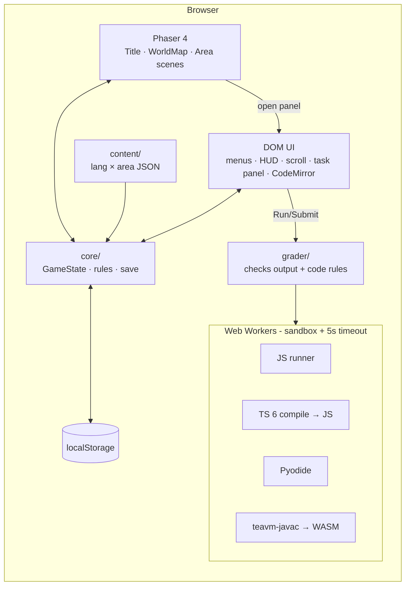

# CodeQuest — Architecture

_Last updated: 2026-10-23 · Adventure library, distinct district layout and layered sound effects_

## 1. Stack
| Area | Pick (version) | Why |
|---|---|---|
| Language | TypeScript 7.0.2 | Types catch bugs early; TS 7 (Go compiler) is the fast, current stable. |
| Build / dev server | Vite 8.3.5 | Standard dev server and browser-game build, with worker/WASM support and current fixes for the 8.3 development-server advisories. |
| Game engine | Phaser 4.2.1 (MIT) | Most-used free 2D web game engine; built-in Tiled tilemaps, arcade physics, sprite animation. |
| Tablet animation | Canvas 2D and an original illustrated foreground sprite, loaded only when requested | Three-second city zoom, wrist lift, settle and screen entry. A live canvas display sits inside the illustrated bezel; a viewport-aware transform fills the screen before opening the DOM editor. Missing art/canvas opens the workspace directly; closing releases the temporary canvas. |
| Maps | Tiled editor (free) → `.tmj` JSON | Industry-standard free map editor that Phaser loads natively. |
| UI panels (menus, scroll, task editor, HUD) | Plain TypeScript + HTML/CSS over the canvas | Text-heavy UI is easier and more accessible in DOM than in canvas; no extra framework needed. |
| Code editor | CodeMirror 6 (`codemirror` 6.0.2, `@codemirror/lang-java` 6.0.2, `lang-javascript` 6.2.5, `lang-python` 6.2.1) | Light, accessible, syntax highlighting for all 4 languages. |
| JavaScript runner | Browser JS engine inside a Web Worker | Free, instant, sandboxed in a worker. |
| TypeScript runner | `typescript` **6.0.3** (installed as alias `typescript-js`) in a worker → type-check + transpile → JS runner | TS 7 has no JS compiler API yet; TS 6 is the last JS-based compiler and runs in the browser. Real type errors are part of learning TS. |
| Python runner | Pyodide 314.0.7 (MPL-2.0) in a worker | Real CPython compiled to WebAssembly, free, offline. |
| Java runner | teavm-javac (Apache-2.0): OpenJDK javac + TeaVM compiled to WebAssembly, in a worker | Real `javac` in the browser, free, no server. Spike passed 2026-10-04 (see §6 limits). Fallback if ever needed: Piston in local Docker. |
| Unit / integration tests | Vitest 5.0.3 | Native to Vite, fast, Jest-compatible API. |
| End-to-end tests | Playwright 1.63.0 | Drives a real browser: needed to test WASM runners and the canvas game. |
| Lint + format | Biome 2.5.15 | One fast tool for both lint and format instead of ESLint + Prettier. |
| Save | `localStorage` (versioned JSON) | No server, no login; enough for MVP. |
| Adventure library | `core/adventures.ts`, `codequest:adventures:v1` | Multiple UUID-keyed version-1 game states. Atomic library writes preserve other adventures; older language slots are imported on read and retained. |
| Sound effects | Native Web Audio oscillators and gain envelopes | Original short cues, one context created after a user gesture, bounded voices and cadence, saved mute preference, hidden-tab suspension. Phaser's unused sound manager is disabled. |
| Art | Generated tech-city and wrist-tablet assets, retained Kenney CC0 sprites and native Phaser/CSS objects | Hoodie developers, transparent city objects, terminals and a 2D illustrated wrist display. The drone and gates use native drawing. See [current screenshots](screenshots/README.md). |
| CI | GitHub Actions | Free for private repos within monthly minutes. |

## 2. Diagram


## 3. Folder structure (planned)
```
src/
  main.ts                 # boot: create Phaser game + UI root
  game/
    scenes/               # BootScene, PreloadScene, TitleScene, WorldMapScene, AreaScene
    entities/             # Hero, Interactable (scroll, task spot, boss)
    input.ts              # arrow/WASD/E/Esc, paused while typing
  ui/                     # DOM screens & panels: language, hero, name, hud, scroll, task, boss, pause, dialogs
  core/
    state.ts              # GameState type + pure reducers (solveTask, loseHeart, spendGems, resetArea…)
    rules.ts              # constants: hearts=3, gem rewards, hint costs, timeout
    save.ts               # load/save/migrate localStorage, per-language slots
    events.ts             # tiny typed event bus between Phaser and UI
  content/
    schema.ts             # TS types + runtime validator for content files
    loader.ts
    data/<lang>/<NN-area>.json   # java/01-variables.json, python/02-conditions.json …
  runners/
    types.ts              # Runner interface: run(code, stdin) → {stdout, stderr, compileError, timedOut}
    worker-host.ts        # spawns worker, enforces timeout (terminate + respawn)
    js.worker.ts  ts.worker.ts  python.worker.ts  java.worker.ts
  grader/
    grade.ts              # runs tests + code rules → GradeResult
public/
  assets/tiles/ sprites/ ui/ fonts/
  maps/area-01.tmj …      # one Tiled map per area (shared by all languages)
  runtimes/java/          # vendored teavm-javac files (6.7 MB, committed, hashes in README)
  runtimes/python/        # Pyodide (copied from node_modules by scripts/copy-runtimes.mjs, git-ignored)
  runtimes/typescript/    # libs.json: ES2022 .d.ts bundle for type-checking (generated, git-ignored)
tests/
  unit/                   # Vitest: core, save, grader, content schema
  e2e/                    # Playwright: flows + "every reference solution passes"
docs/
```

## 4. Data model

**Content file** (`src/content/data/<lang>/<NN-area>.json`)
```ts
type Area = {
  id: "variables" | "conditions" | "loops" | "arrays" | "functions" | "objects" | "abstraction";
  order: number; name: string;            // "Variable Village"
  lesson: { title: string; pages: { heading: string; body: string /* markdown */; code?: string }[] };
  tasks: Task[];                          // exactly 8, easy → hard
  boss: Boss;
};
type Task = {
  id: string; title: string; difficulty: "easy" | "normal" | "hard";
  prompt: string;                         // markdown
  starter: string; solution: string;      // solution is used by tests only, never shown in full
  tests: { stdin?: string; expectedStdout: string }[];
  rules?: { kind: "mustMatch" | "mustNotMatch"; pattern: string; message: string }[]; // regex on source
};
type Boss = Omit<Task, "difficulty"> & { name: string; hints: { cost: 1 | 2 | 3; text: string }[] };
```

**Save** (`localStorage["codequest:v1:<lang>"]`)
```ts
type Save = {
  version: 1; lang: "java" | "javascript" | "typescript" | "python";
  adventureId?: string; // UUID for new adventures; deterministic legacy-<lang> for imports
  hero: { kind: "boy" | "girl"; name: string };
  currentArea: string; position?: { x: number; y: number };
  discoveries?: { beacon?: "garden" | "arcade" };
  games?: { packetDashBest: number; signalStackBest?: number }; // optional per-adventure arcade records
  areas: Record<string, {
    solved: string[]; lessonsFound: boolean; gems: number; hearts: number;
    hintsBought: number; bossDefeated: boolean; finaleStage?: 0 | 1 | 2;
    drafts: Record<string, string>;
  }>;
  updatedAt: string;
};
```
Gems are stored per area: an area reset removes only that area's gems, and gems can only be spent on that area's boss.

The primary library is `codequest:adventures:v1`, containing `{version: 1,
adventures: GameState[]}` with unique validated adventure IDs. `loadAdventures`
merges valid older language slots without writing to storage. `saveAdventure`
validates the entire existing library before atomically updating one adventure.
Corrupt/future libraries and unreadable legacy slots are preserved. The UI keeps
the latest valid per-language slot as a compatibility snapshot; the library is
the source for choosing any adventure. A new UUID creates another save without
confirmation or replacement. The tablet uses `codequest:tablet:v2:<adventureId>`;
only imported legacy adventures fall back to their older per-language draft.

The title groups every saved journey under its language. Progress stays in the
browser profile and autosaves to the library. Portable backups use the
`codequest-adventure` JSON format, version 1, and include one full game state
plus the optional tablet draft. Import validates before writing and assigns a
new UUID, so loading a file adds an adventure without replacing another. The
browser's file picker and download APIs keep file access explicit.

Variable District's firewall approach has two free, worker-run diagnostics
before its normal graded boss. Restored power and operator checkpoints live in
the optional bounded `finaleStage` field; existing version-1 saves default to
zero. `HubSignals` renders those checkpoints as ground lights, and the tablet
mission log can reopen the hub diagnostics or review the completed sequence.
The diagnostic runner never spends hearts or gems; the original firewall
grader, hints and heart policy remain unchanged.

Touch players get a thumb-sized directional pad and interact button. Held
pointer controls feed the same collision-limited movement update as the
keyboard. Tap-to-walk also uses world coordinates and the same solid map data.

`district-layout.ts` defines independent entrances, walk bounds, terminal routes,
lesson and boss positions. Variable District retains its campus. Logic Junction
uses original skyrail artwork, a transparent routing-hub sprite and relocated
solid props. District changes destroy the previous scenery and its tweens,
reposition live markers/collision shapes and validate saved coordinates against
the new layout. Out-of-bounds legacy positions return to the district entrance.

The optional `discoveries` field is additive: existing version-1 saves remain valid.
The beacon accepts only `garden` or `arcade`; malformed known discovery fields are
rejected before overwriting a save. `lightBeacon` requires the repaired drone (or
an existing discovery), changes no area counters and is idempotent for the same
choice. Area retries retain discoveries; a new adventure clears them. The UI
runs code in the existing worker, requires an exact event-name output, and keeps
a receipt tied to the current code and selection before allowing activation.
Closing or changing either invalidates that receipt. Output is the acceptance
criterion; the free activity does not enforce a particular source-code syntax.

Sound preferences are separate from progress at `codequest:audio:v1` (`on` or
`muted`) and `codequest:volume:v1` (0–1). One native context unlocks on a trusted
gesture. Cached noise buffers, filters, low impact tones and bell partials make
textured footsteps, tactile clicks, swishes and richer result cues. Voices and
cadence are bounded; active audio stops when muted or hidden. Unsupported audio
and unavailable preference storage leave gameplay intact.

### Implemented core API

`src/core/state.ts` implements this version-1 shape as `GameState`, with typed
area IDs and read-only fields. New games initialize independent state for all
seven areas. Every state-changing function accepts an explicit `updatedAt`
timestamp; it does not read the clock, access storage or call Phaser.

| Function | Contract |
|---|---|
| `createGame(lang, hero, at)` | Create a fresh language slot, starting in Variables with three hearts per area. |
| `isAreaUnlocked` / `enterArea` | Require all earlier bosses to be defeated; changing maps clears position but preserves each area's progress. |
| `discoverLesson` | Mark the current area's lesson as found permanently through retries. |
| `canSolveTask` / `solveTask` | Require the current area's eight distinct tasks in order; award each task's content-defined difficulty reward once, after the grader accepts it. |
| `canFightBoss` / `defeatBoss` | Require all eight tasks; the caller reports boss victory only after all checks pass. Victory unlocks the next area without entering it automatically. |
| `buyNextHint` | Spend only the current area's gems after the boss gate opens, using ordered hint costs from content; unavailable or unaffordable purchases do nothing. |
| `applySubmissionFailure(state, submittedAreaId, reason, at)` | Charge one heart for wrong output, failed code rules or run timeout. Compile/runtime/runner errors and compile timeouts are free. Results from another area are ignored. Returns `{ state, areaReset }`. Run never calls this reducer. |
| `resetArea` | Reset only the current unfinished area's tasks, gems, hints, drafts and position; restore three hearts and retain found lessons. Completed areas remain completed. |

Rejected actions return the original state, including its timestamp. On the
last heart, `applySubmissionFailure` performs the reset atomically and reports
`areaReset: true` so the UI can show the out-of-hearts panel and respawn at the
map entrance. The grader and gameplay screens remain separate roadmap tasks.

### Implemented browser-save API

`src/core/save.ts` persists the same version-1 structure in
`localStorage["codequest:v1:<lang>"]`. It resolves browser storage only when a
function is called, and accepts an injected `SaveStorage` for tests or other
adapters. Importing it requires no browser globals.

| Function | Result |
|---|---|
| `saveKey(lang)` | The versioned key for one of the four language slots. |
| `isGameState(value)` | Check shape, valid hero/name, timestamp, finite coordinates, integer counters, unique solved IDs, gem/hint bounds and area unlock consistency. Does not check task IDs against lesson content yet. |
| `loadGame(lang, storage?)` | `{ status: "loaded", state }`, `empty`, `corrupt`, `unsupported-version` (with its version), or `storage-error` (with `quota`/`unavailable` reason). A language mismatch is corrupt. |
| `saveGame(state, storage?)` | `saved`, `invalid`, or `storage-error`. Validates state and serialized output before a single `setItem` call. Invalid writes and browser quota failures preserve the previous successful save. |

Loads never modify storage. No automatic migration or deletion is attempted;
old/future version metadata in the current namespace is reported to the UI.
Other namespaces and language slots remain untouched. The future New/Continue
screens must obtain confirmation before replacing an existing game, and the
gameplay controller must call `saveGame` after persistent state changes and
handle failure results. The playable controller in `src/ui/app.ts` now saves
task, heart, hint and draft changes immediately, and position during walking or
when leaving a panel/page. Storage failures are shown in the HUD. Playwright
verifies reload persistence; test-only hooks are excluded from production builds.

### Playable first area

`src/ui/app.ts` connects the DOM menus and panels to the core reducers, saves,
content loader and worker host. `BootScene` renders the village and handles
keyboard movement, obstacle checks and nearby interactions. Keyboard movement
is paused while menus or the code editor are open. Closing a running editor
terminates its worker and invalidates its pending result.

The `src/content/data/<lang>/01-variables.json` and `02-conditions.json` files
contain each district's paged lesson, eight tasks, boss, hints and reference programs.
`loadArea` selects validated content by language and area ID; availability gates
world-map travel. HUD, drafts, penalties, markers and victory use the active area.
`src/grader/grade.ts`
normalizes line endings, checks output and code rules, and classifies failures
for the heart reducer. All player programs execute in workers, including the
new plain JavaScript worker. The first editor is a plain text area, and village
layout is `src/content/village.json`, with separate solid-object footprints,
directional walking, following camera and per-district tint/signage. CodeMirror,
Tiled and the remaining five areas remain follow-up work.

The developer tablet keeps a per-adventure project (`codequest:workspace:v1:<adventureId>`)
with relative file paths and folder names in browser storage. It can also import a
player-selected local folder through the File System Access API and write edits
back to that folder while connected. Its Explorer selects a target folder, so new
items need only a name; files and folders can be renamed or deleted, and open
files appear as tabs above the Monaco editor with individual close controls.
Closing a tab preserves its file in the project tree; at least one file remains
open, and the active tab moves to a neighbor when closed. Folder rows separate selecting a
creation destination from expanding or collapsing its contents. The selected Java entry file plus
every other `.java` file goes to the Java worker. New Java files get a
`public class` scaffold matching the filename, `import java.util.*;`, and a
package derived from their folder under `src/`. JavaScript and TypeScript local named/default imports and Python
`from module import Name` statements are bundled from project files before
running. External packages are not downloaded. The field guide is hidden while
modal pages are open so it cannot cover tablet or arcade content.

## 5. Screens (no URL routes — single page)
Title (New / Continue) → Language → Hero → Name → World Map ↔ Area (HUD + panels: Scroll, Task, Boss, Pause, Out of hearts, Victory).

## 6. Code running and grading
1. `worker-host` keeps one warm worker for the chosen language and sends it `{id, code, stdin, files?}`. Runs are **queued**: one request inside the worker at a time.
2. The worker compiles if needed (TS → JS, Java → WASM) and runs it, capturing stdout/stderr (JS/TS: patched `console.log`; Python: Pyodide `setStdout`; Java: TeaVM stdout hook).
3. Timeouts: compiling has a 20 s safety cap; when the worker posts `{phase: "running"}` the 5 s **run** timeout starts. On timeout the host calls `worker.terminate()` and the next run spawns a fresh worker. Loading a runtime has a 60 s cap. If the runner itself fails (load error, crash, restart) the result has `runnerError`.
4. `grade()` runs every test case, compares trimmed stdout (normalised line endings) and checks `rules`. Result: `{passed, failedCheck?, compileError?, perCase[]}`.
5. Output is capped at 64 000 characters (stops print-in-endless-loop).
6. **Java limits (teavm-javac):** no `Scanner`/`System.in` (the Java worker ignores `stdin`); `String.format` with `%f`/`%n` and `DecimalFormat` crash; runtime errors come as WebAssembly traps (e.g. "array element access out of bounds"), which the grader will translate into beginner-friendly messages. Measured: runtime load ~0.5–0.9 s, compile 1.4–4.4 s, run < 50 ms. Show a "Compiling…" indicator. Any `runnerError` result makes the host replace the worker.
7. **Python (Pyodide):** a driver checks syntax with `compile()` (→ `compileErrors`), then `exec`s in a fresh namespace with its own `sys.stdin` (StringIO); afterwards it restores streams, `print`/`input`, the recursion limit and removes newly imported modules, so runs never affect each other; errors come back as `"IndexError: … (line N)"`. `input()` reads the request's `stdin`; no stdin → `EOFError`. Measured: load ~2.4–5.4 s, runs in ms.
8. **TypeScript:** `typescript-js` (TS 6.0.3) builds a program from `main.ts` + a small `globals.d.ts` (console, `prompt`, timers) + ES2022 libs (parsed once, reused). Strict mode; every file is a module. Errors → `compileErrors` (line, column). Output JS + source map run through `js-exec.ts`.
9. **JavaScript execution (`js-exec.ts`, shared):** code runs in an `AsyncFunction` (top-level `await` works) inside a block, so names like `close` or `console` can be redeclared; worker globals (`self`, `fetch`, `postMessage`…) are shadowed. `console.log` uses `inspect.ts`, a port of Node's formatter tested against real Node. `prompt()` reads stdin lines. Timers are wrapped: the run waits for them like Node, errors inside them are runtime errors, leftovers are cleared. If built-ins were changed, the result has `recycle` and the host replaces the worker. Runtime error line comes from the `main.js` stack frame (mapped to the TS line for TypeScript). Measured TS: load ~0.6–1.6 s, compile ~30–90 ms (`skipLibCheck`).
10. Hearts: compile error, runtime error, `runnerError` or `timedOut: "compile"` → **no heart lost**. Wrong output, failed rule or `timedOut: "run"` (endless loop) → −1 heart.
11. Security: the test hook `window.__codequest` exists only in `vite build --mode e2e`. Player output must be rendered with `textContent`, never `innerHTML`. Later: random per-request nonce and result-shape validation so player code can't fake a result (Python can reach `js.postMessage` via Pyodide's `js` module; Java via JSO).

## 7. Integrations
None in MVP (no network APIs). Later: Google/GitHub OAuth + a small backend for cloud save; optional AI tutor.

## 8. Auth
None in MVP. Later: OAuth via a hosted auth service (decide in a future DECISIONS entry).

## 9. Environment variables
None needed for MVP. `.env.example` lists placeholders only (e.g. `VITE_JAVA_RUNNER=wasm|piston`, `VITE_PISTON_URL=http://localhost:2000` for the fallback).

## 10. Testing strategy
- **Unit (Vitest):** core reducers (hearts, gems, reset, unlocks), save/migrate, grader comparison and rules, content schema validation for every file.
- **Integration (Vitest):** JS runner in Node, grader + JS runner end to end.
- **E2E (Playwright, Chromium):** new game flow (language → hero → name → map); walk to a task, solve it, gem +1; wrong submit, heart −1; lose all hearts, area resets; boss with hints; reload keeps progress; **every task's reference solution passes in the real browser runner for all 4 languages**.
- CI runs lint, types, unit and Chromium E2E on every push and pull request.

## 11. Deployment and cost
- **Public:** https://codequest-game-inky.vercel.app/, a separate Vercel static Vite project. Source: https://github.com/amirh3sam/codequest-game. See `DEPLOYMENT.md` for the release workflow.
- **Local:** `npm run dev` for development; `npm run build` then `npm run preview` for the production build. All code execution stays in browser workers.
- **Monthly cost: $0.**
